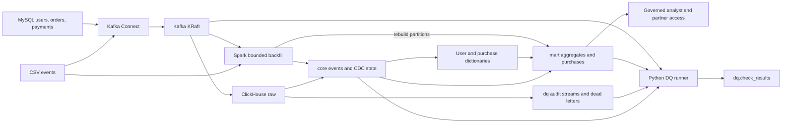

# Insurance Data Platform

**ClickHouse-native streaming analytics for insurance events, with MySQL CDC,
governed data marts, data-quality checks, and Spark recovery.**

This project follows an insurance event from a CSV file through Kafka into analytical
tables enriched with users, product orders, and payments. ClickHouse materialized
views handle incremental processing; Python monitors quality, and PySpark repairs
bounded data gaps. A Docker Compose stack and synthetic fixtures make the pipeline
reproducible locally.

[Quick start](#quick-start) · [Operating guide](docker/README.md) ·
[Technical report](docs/report.md) · [Test plan](docs/TEST_PLAN.md)

## What it delivers

| Capability | Implementation |
|---|---|
| Event ingestion | CSV → spooldir source connector → Kafka → ClickHouse; validated Python producer as a fallback |
| Change data capture | Debezium snapshots and binlog changes for MySQL users, four product tables, and financial orders |
| Event analytics | Aggregate states by date, event type, channel, city, and device; counts, distinct users/sessions, premium sums and averages |
| Purchase enrichment | Unified third-party, body, medical, and fire orders joined with payment information through dictionaries |
| Governance | Masked analyst views, partner row policies, column grants, settings limits, and quotas |
| Data quality | Twelve checks covering freshness, lag, completeness, drift, duplicates, load, and enrichment |
| Recovery | Spark CSV/Kafka backfills with gap filling, staged monthly replacement, mart repair, and run auditing |

## Architecture



The [complete diagram](docs/architecture.mmd) includes refreshes, staging, source
manifests, and repair paths. The [technical report](docs/report.md) explains the
trade-offs, including dictionary lookup costs and materialized-view limitations.

## Quick start

For an interview walkthrough, see [the demo guide](docs/demo.md). After installing
dependencies and starting Docker Desktop, `./scripts/demo.sh start` starts the stack,
seeds an empty event table, shows SQL results, and opens Kafka UI and ClickHouse SQL.
Use `./scripts/demo.sh dq` for checks/results and `./scripts/demo.sh reset --yes`
to delete all local Compose data and rebuild the synthetic pipeline from scratch.

### Prerequisites

- Python **3.11** and **uv**.
- Docker Desktop or Docker Engine with **Compose v2**, running Linux containers.
- **Java 17** with `JAVA_HOME` configured for local Spark transforms and backfill tests.
- Available host ports: `3306`, `8080`, `8081`, `8083`, `8123`, `9000`, and `9092`.

Run from the repository root:

```sh
uv sync --extra integration --extra spark
make up
make apply-sql
make seed
```

`make up` generates local secrets and synthetic order fixtures, builds the Connect
image, and waits for service healthchecks. `make apply-sql` installs the pipeline in
numbered order. `make seed` registers the connectors, waits for users, orders,
payments, and dictionaries, then publishes the synthetic event file.

Apply SQL **before** seeding. Each seed invocation replays the source file; reruns
can temporarily inflate incremental aggregates until reconciliation. The bundled
events have historical timestamps and intentionally include a duplicate and an
unknown user, so they do not imply an all-PASS DQ dashboard.

| Service | Local endpoint |
|---|---|
| Kafka UI | `http://localhost:8080` |
| Kafka Connect REST | `http://localhost:8083` |
| Schema Registry | `http://localhost:8081` |
| ClickHouse HTTP / native | `localhost:8123` / `localhost:9000` |
| Kafka bootstrap | `127.0.0.1:9092` |
| MySQL | `localhost:3306` |

Schema Registry is available in Compose; the current connectors use schemaless
JSON and do not enforce registry compatibility. See the
[operating guide](docker/README.md) for credentials, service configuration,
connector troubleshooting, and the optional three-broker profile.

Stop the stack while preserving its volumes:

```sh
make down
```

## Query the marts

Run these queries in a ClickHouse SQL client connected to the local instance.
Aggregate columns contain states, so use the matching merge functions:

```sql
SELECT
    event_date,
    event_type,
    countMerge(event_count) AS events,
    uniqMerge(user_count) AS users,
    sumMerge(premium_sum) AS total_premium
FROM mart.user_event_agg
GROUP BY event_date, event_type
ORDER BY event_date, event_type;
```

Analysts consume the masked purchase view:

```sql
SELECT event_date, product_type, count() AS purchases, sum(paid_amount) AS paid
FROM gov.purchase_events_masked
GROUP BY event_date, product_type
ORDER BY event_date, product_type;
```

These aggregate distinct-user counts are computed by merging states, rather than
adding per-bucket distinct counts. User login provisioning and analyst quota bindings
are operator steps described in the
[governance guide](docker/README.md#governance-and-account-provisioning).

## Monitor and recover

```sh
# Collect and persist the twelve DQ results; print JSON and exit 1 if any FAIL.
make dq

# Inspect a bounded recovery without changing event or mart data.
make backfill ARGS='--source csv --path tests/fixtures/user_events.csv --start 2025-10-16T00:00:00Z --end 2025-10-17T00:00:00Z --dry-run'
```

DQ results are written to `dq.check_results`; recovery runs are audited in
`dq.backfill_runs`. Thresholds live in
[thresholds.yaml](src/azki_pipeline/dq/thresholds.yaml). A fresh deployment can WARN
for missing source manifests, heartbeat evidence, or seven days of volume history.
Use an independent hourly source-count manifest for completeness checks; see
[data-quality operations](docker/README.md#data-quality-checks).

Actual repairs require paused event writers and purchase refreshes, serialized jobs,
and `--writers-paused`. `fill-gaps` inserts missing event keys; `replace-partition`
requires an authoritative snapshot of complete UTC months. Both rebuild affected
mart partitions. Read the [backfill runbook](docker/README.md#spark-backfill) before
applying either mode. If `SPARK_HOME` points to another Spark release, unset it so
the installed PySpark distribution is used.

## Correctness and operating boundaries

- **Deduplication is eventual.** FINAL reads resolve replacement rows; they do not
  retract aggregate states already emitted by duplicate deliveries. Monthly
  reconciliation rebuilds aggregates from deduplicated events.
- **Enrichment converges through repair.** Dimension changes do not trigger an event
  insert MV. A minute refresh repairs recent purchases; historical months need an
  explicit rebuild. Dictionaries supply current attributes rather than historical
  dimensions as of event time.
- **Purchase attribution is explicit.** Events lack order IDs. Matching requires an
  unambiguous user/session order and an event/order time difference within one hour.
- **Recovery requires coordination.** A partition swap is atomic per table partition;
  the full recovery across tables is not a transaction. Shared staging requires
  serialized jobs, and existing-key collection currently uses driver memory.
- **Compose is a local demonstration.** The default broker/controller and ClickHouse
  services are single-node. The optional broker profile retains replication factor
  one. Production replication, Keeper, authentication, scheduling, and capacity
  planning are discussed in the [report](docs/report.md).

## Development and validation

The project follows a test-first workflow with unit, contract, integration, and E2E
layers. Tests use synthetic fixtures; integration tests use isolated Testcontainers
databases/topics, while E2E tests exercise the Compose stack.

```sh
make test-unit          # Includes local Spark; requires Java 17, no Docker
make test-contract      # SQL, schema, config, and documentation checks
make test-integration   # Testcontainers: ClickHouse and Kafka
make test-e2e           # Full Compose stack; includes Connect outage/restart
make lint              # Ruff and deployment SQL parsing
```

The latest recorded full runtime baseline is **195 unit, 52 integration, and 6 E2E
cases passing**. Phase 8 recorded **46 contract cases passing**; documentation
changes add further contract coverage. These are functional test results, not
production throughput benchmarks. Detailed results and the recorded EXPLAIN
partition-pruning evidence are in the [implementation notes](docs/implementation-notes.md).

## Repository guide

| Path | Purpose |
|---|---|
| [`connect/`](connect/) | Debezium and spooldir connector configurations |
| [`contracts/`](contracts/) | Event and user JSON Schemas |
| [`docker/`](docker/) | Compose services, Connect build, and server configuration |
| [`sql/`](sql/) | Numbered deployment SQL, collectors, and repair statements |
| [`src/azki_pipeline/`](src/azki_pipeline/) | Producer, connector management, SQL runner, DQ, and Spark jobs |
| [`tests/`](tests/) | Synthetic fixtures and all four test layers |
| [`docs/`](docs/) | Data contract, architecture, technical report, and evidence |

## Documentation

- [Local operations and troubleshooting](docker/README.md)
- [Technical report and production considerations](docs/report.md)
- [Full architecture diagram](docs/architecture.mmd)
- [Source data contract](docs/data_contract.md)
- [Test plan and case IDs](docs/TEST_PLAN.md)
- [Implementation decisions and measured evidence](docs/implementation-notes.md)
- [Synthetic fixture notes](tests/fixtures/README.md)
- [Phased implementation prompts](prompts/PROMPTS.md)

Real CSVs belong in gitignored `data/`. Generated credentials and order fixtures
remain under ignored `docker/secrets/` and `docker/generated/`; committed tests
and examples use synthetic data only.
